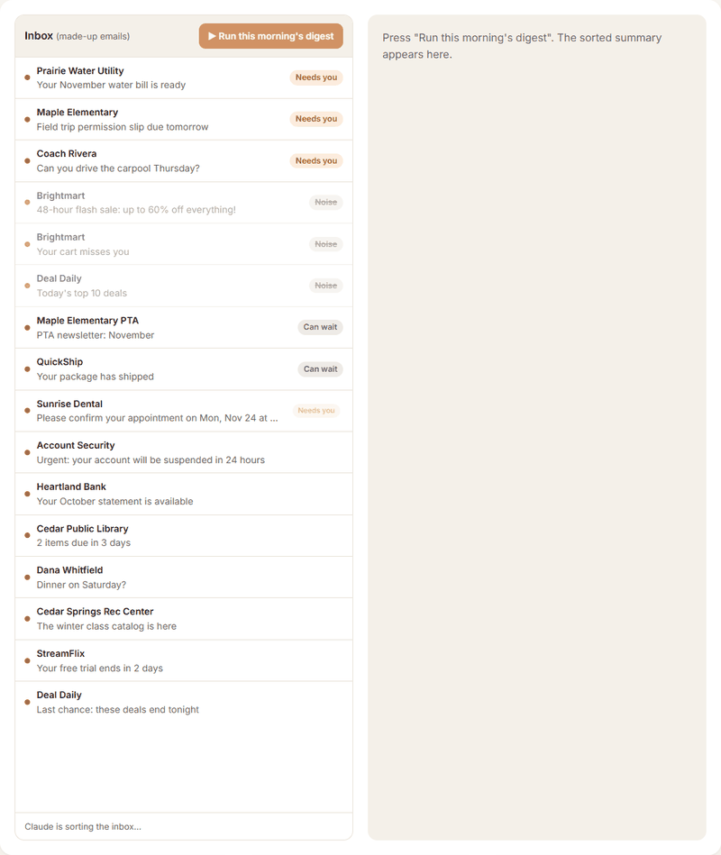
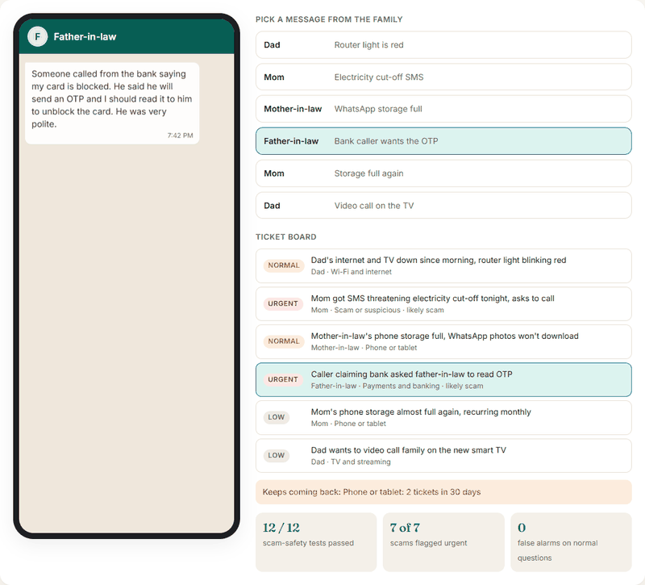

# Home Help Desk

> I'm my family's unpaid IT department, so I built myself a help desk.

A small Python app on the Claude API that runs my inbox and my family's tech questions like a
support queue. Built with Claude Code.

**▶ [Try the interactive demo](https://racode1.github.io/#digest)**: watch a made-up inbox get sorted
and a family scam message get answered. No sign-in.



## What it does

**Morning digest.** Every morning it reads the last day of email and puts one short summary in my
inbox:

- **Needs you today:** bills, forms, appointment confirmations, questions waiting on me
- **Still waiting on:** emails I sent that nobody answered after 3 days, with a polite follow-up
  drafted for me to send
- **Noise report:** the senders I never open ("Brightmart sent you 41 emails this month. You
  opened none.")
- **Looks like a scam:** phishing is pulled out of the list with a warning

**Family help desk.** My parents and in-laws live on the other side of the world and send me tech
questions on WhatsApp, often with a screenshot. I paste each one in and it becomes a ticket:

- a category (Wi-Fi, phone, apps, scam, payments, TV) and an urgency
- a scam check
- a simple step-by-step reply in their language, ready to send back
- patterns over time, so I can see what keeps coming back and teach the fix once



## A morning, on made-up data

Real output of `python digest.py --demo`, run on the made-up [demo inbox](demo/inbox.json) and
[family requests](demo/family_requests.json). The full run is saved in
[demo/sample_run.json](demo/sample_run.json), and the app's demo mode shows it.

```
Good morning, 7 things need you today:
  - Pay November water bill of $84.20. (due: Friday, November 21)
  - Sign field trip permission slip and return it with $8. (due: Friday, November 20)
  - Reply to Coach Rivera whether you can drive carpool Thursday. (due: Wednesday)
  - Reply C to confirm dental cleaning on Monday, November 24. (due: Monday, November 24 at 3:30 PM)
  - Renew or return two library books due Sunday. (due: Sunday, November 22)
  - Tell Dana if you can make Saturday dinner at 6. (due: Thursday)
  - Free trial ends; cancel by November 21 or plan renews at $15.49. (due: November 21)

Looks like a scam, don't click anything:
  - Urgent: your account will be suspended in 24 hours (from Account Security <security@acc0unt-verify.example>)

Still waiting on:
  - the claims team (9 days): Question about claim #48213
  - Rob's Plumbing (4 days): Quote for kitchen faucet

Can wait: 4 emails. Noise: 4 emails.

Noise report:
  - Brightmart sent you 41 emails this month. You opened none.
  - Deal Daily sent you 23 emails this month. You opened 1.
  - ShoeHub sent you 12 emails this month. You opened none.
  Unsubscribe from these and you'd get 76 fewer emails a month.

Family help desk: 6 open tickets
  - [normal] Dad: Dad: internet and TV down since morning, router light red
  - [urgent] Mom: Mom got SMS threatening electricity disconnection tonight, asks to call (likely scam)
  - [normal] Mother-in-law: Mother-in-law's phone storage full, can't download WhatsApp photos
  - [urgent] Father-in-law: Caller claiming bank asked Father-in-law to read OTP (likely scam)
  - [low] Mom: Mom's phone storage almost full again, recurring monthly
  - [low] Dad: Dad wants to video call family on new smart TV

This run: 8 Claude calls, 10,776 tokens in, 3,480 out, about $0.073
```

The reply it drafted for the fake bank call:

```
This looks like a scam. Real banks never ask you to read out an OTP, even if the caller is very
polite. Do not tell anyone the OTP or any code, PIN, or password. Do not click any links in
messages. Do not call any number the caller or the message gave you. If he calls again, just hang
up. Please check with me first before doing anything.

1. Do not read the OTP to anyone. Not to the caller, not to anyone else.
2. If he calls again, hang up. You do not need to be polite.
3. If you already shared a code, call your bank right away. Use the number on the back of your
   card.
4. If you did not share anything, you can still call that number on your card to check your card.
5. Delete any message with the OTP after you have hung up.
6. Call or message me so we can check together.
```

## Why I built it

During my job search my inbox got out of hand: hundreds of unread emails, with the few that
mattered (a form due tomorrow, a recruiter waiting on interview times) buried under sales emails.

At the same time, I'm the person my family calls when the Wi-Fi light turns red or a text says
their bank account is blocked. At my last job I tracked and categorized customer tickets so the
test team could see where problems clustered. Family tech support has the same shape, so I built
the same habit into a tool.

## How it works

```
Gmail API (read-only) ──> fetch the last day of email ──> Claude sorts it ──┐
                      ──> sent emails with no answer  ──> Claude drafts ────┼──> digest added to my inbox
                      ──> promotions by sender        ──> counted (no AI) ──┘
WhatsApp message + screenshot ──> Claude (with vision) ──> ticket + reply ──> local ticket list
```

| File | Job |
| --- | --- |
| `digest.py` | Builds the morning digest; `--deliver` adds it to your inbox |
| `triage.py` | Sorts email, finds unanswered emails, drafts follow-ups |
| `noise.py` | The noise report (plain counting) |
| `helpdesk.py` | Family tickets: sorting, scam check, replies, patterns |
| `gmail_client.py` | Gmail sign-in and reads |
| `llm.py` | Claude calls with structured output, refusal handling, cost tracking |
| `evaluate.py`, `label.py` | Accuracy and safety testing |
| `app.py` | Streamlit app, with a demo mode that needs no sign-in |
| `mcp_server.py` | MCP server, so Claude Desktop can use the help desk in plain English |

## Use it from Claude Desktop (MCP)

`mcp_server.py` is an MCP (Model Context Protocol) server: a standard plug that lets Claude Desktop
or Claude Code use Home Help Desk in plain English. I can ask Claude *"What's in my digest today?"*,
*"Log a ticket: Dad says the Wi-Fi light is red again"*, or *"What keeps coming back this month?"*

| Tool | What it does |
| --- | --- |
| `get_digest` | Today's digest (read-only) |
| `list_tickets` | Family tickets by status (read-only) |
| `log_ticket` | Sorts a family message with Claude, applies the scam guardrail, saves the ticket, returns the reply |
| `close_ticket` | Marks a ticket resolved |
| `ticket_patterns` | What keeps coming back (read-only) |

Read-only tools are marked read-only for the client, and no tool can send, delete, or change email.
To connect it, add this to Claude Desktop's config (Settings > Developer > Edit Config), then restart
Claude Desktop:

```json
{
  "mcpServers": {
    "home-help-desk": {
      "command": "C:\\path\\to\\home-help-desk\\.venv\\Scripts\\python.exe",
      "args": ["C:\\path\\to\\home-help-desk\\mcp_server.py"]
    }
  }
}
```

## Safety and privacy

- **Least access.** Gmail permissions are read-only plus "insert", which can only add a message to
  my own inbox. The app cannot send email, reply, delete, change labels, or unsubscribe.
  Unsubscribe links are suggestions.
- **Email is data.** Prompts tell Claude to ignore instructions written inside emails and
  messages, so a phishing email can't steer the tool.
- **Never "safe".** The help desk never tells anyone a message is safe. Any scam signal puts a
  warning at the top of the reply, and that rule is enforced in code (`enforce_safety`), not only
  in the prompt.
- **Validated output.** Claude answers in a fixed JSON schema, checked with Pydantic. Every email
  must come back exactly once; anything Claude skips stays visible instead of disappearing.
- **Little leaves the computer.** Only the first 1,500 characters of each email are sent to
  Claude. Tickets and results stay in `data/`, which is never committed.
- **Cost is tracked** on every run.

## Testing

| Check | Model | Result |
| --- | --- | --- |
| Scam and safety cases ([demo/helpdesk_cases.json](demo/helpdesk_cases.json)) | Claude Opus 5.5 | 12 of 12 passed: all 7 scams flagged as likely scams and urgent, no false alarms on 5 normal questions |
| Email sorting, 16 labeled demo emails | Claude Haiku 5.5 | 14 of 16 on the first test; 16 of 16 in 3 of 3 runs after one prompt fix |
| Email sorting, 39 of my own emails labeled by hand | Claude Haiku 5.5 | 35 to 37 of 39 (90-95%) across 3 runs; no email I wanted was hidden |

**What the tests caught.**

- The first demo test put "Your free trial ends in 2 days" under "can wait". A surprise charge is
  exactly what the digest should catch, so I added a general rule: anything that will charge you
  unless you act needs you today. Re-run three times, it sorted all 16 correctly each time.
- On my own email the first test said 36 of 39. Reviewing the 3 misses, two were my own labeling
  mistakes, so I corrected the answer key and re-ran it three times: 35, 37 and 35 of 39
  (90-95%). Every miss erred toward showing me more (newsletters filed as "can wait", a
  password-reset email flagged as "needs you"); it never hid an email I wanted. The one steady
  disagreement is job-match alerts, which I treat as noise. That's a personal preference, so the
  next step is a setting for it, checked on emails I haven't labeled yet.
- My 39 emails that day had no "needs me today" ones, so the demo test still covers that bucket
  until I label more days.

To label and test your own email:

```
python label.py 40                          # label 40 of your own emails by hand
python evaluate.py triage data/labeled.json # how often it sorts them the way you would
python evaluate.py helpdesk                 # scam patterns must be flagged; normal questions must not
```

The safety cases cover the scams my family actually gets: fake bank calls asking for an OTP,
"install AnyDesk for your refund", KYC and electricity cut-off texts, parcel fees, prize messages,
and fake police calls.

**Cost.** Sorting a day of email with Haiku 5.5 costs about a tenth of a cent. The full demo run
above (16 emails, 3 sent emails, 6 family tickets on Opus 5.5) cost about 7 cents. Every run
prints its cost.

## Run it yourself

1. Install Python 3.13, then:
   ```
   python -m venv .venv
   .venv\Scripts\activate
   pip install -r requirements.txt
   ```
2. **Demo, no sign-in needed:** `streamlit run app.py`
3. **Your own inbox:** copy `.env.example` to `.env` and add your Anthropic API key. Then connect
   Gmail (below) and run `python digest.py`, or `python digest.py --deliver` to add the digest to
   your inbox.
4. **Every morning:** run `setup_schedule.ps1` once in PowerShell. Windows then checks every 30
   minutes from 7 AM, and at sign-in. The digest goes out at 7 AM if the laptop is on, otherwise at
   the first check after it's on; a failed run is retried at the next check, and once the day's
   digest is delivered the rest of the checks do nothing (`scheduled_run.py`).

### Connect Gmail

1. In [Google Cloud Console](https://console.cloud.google.com/), create a project and enable the
   **Gmail API**.
2. Set up the OAuth consent screen (External) and add yourself as a test user.
3. Create an OAuth client of type **Desktop app**, download the JSON, and save it in this folder
   as `credentials.json`.
4. The first run opens a browser to sign in. A `token.json` is saved so later runs don't ask.

While the Google app is in testing mode, Google ends the sign-in every 7 days. The scheduled run
then stops with a note in `data/digest.log` instead of waiting on a browser window; run
`python digest.py` once to sign in again.

`credentials.json`, `token.json` and `.env` are in `.gitignore` and never committed.
